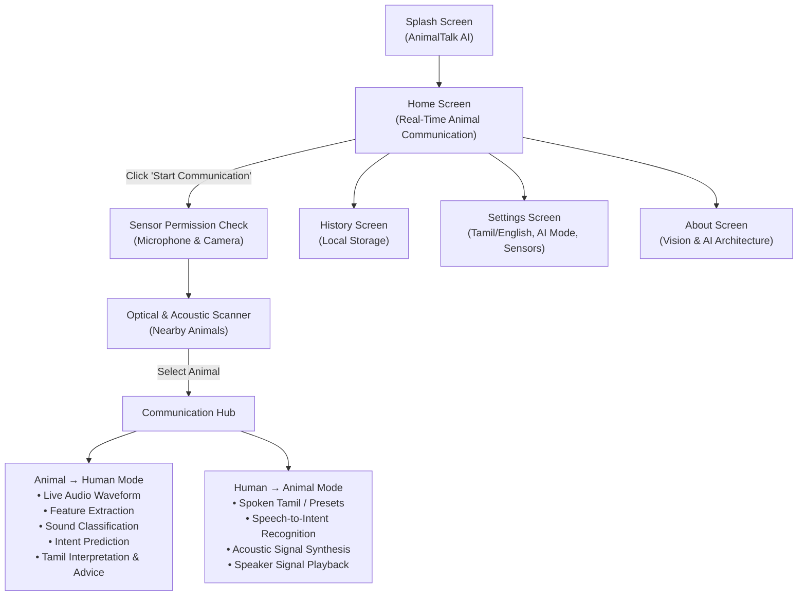

# AnimalTalk AI (அனிமல்டாக் ஏஐ) 🐾
### Real-Time Animal Communication Mobile Application

**AnimalTalk AI** is an AI-powered real-time animal communication application designed to help humans understand animal vocalizations and communicate meaningfully with animals using Tamil interpretations and species-calibrated acoustic signals.

---

## 🌟 Key Principles & Scientific Disclaimer

> [!IMPORTANT]
> **Ethical Communication Notice**: AnimalTalk AI **does not claim** to literally translate animal language into human sentences. Instead, it processes bio-acoustic audio features and optical cues to present **probabilistic behavioral intent, emotional arousal, and vocalization interpretation**, accompanied by a confidence score and species-specific guidance.

---

## 📱 User Flow



---

## 🏗️ Architecture & Technology Stack

- **Framework**: Flutter 3.44+ (Dart 3.12+)
- **UI Design System**: Material 3 with Nature Emerald/Amber theme and responsive layout
- **State Management**: Riverpod (`NotifierProvider` & `Notifier`)
- **Localization**: Tamil (Default, `ta-IN`) and English (`en-US`)
- **Storage**: Local persistence via `SharedPreferences` (Repository pattern prepared for Firebase/Cloud sync)
- **AI Integration**: Pluggable abstraction layer supporting Mock, REST Cloud API, and Edge On-Device (TFLite/ONNX)

### Project Directory Structure

```text
lib/
├── main.dart                                    # Application entrypoint & ProviderScope
├── app/
│   ├── app.dart                                 # MaterialApp & theme configuration
│   ├── routes.dart                              # Named route navigation
│   └── theme.dart                               # Material 3 light/dark nature themes
├── core/
│   ├── constants/
│   │   └── app_constants.dart                   # Brand text, disclaimers, config
│   ├── permissions/
│   │   ├── permission_service.dart              # Permission service interface
│   │   └── permission_service_impl.dart         # Graceful mobile/desktop permission handler
│   └── providers/
│       └── service_providers.dart               # Riverpod dependency injection registry
├── models/
│   ├── animal.dart                              # Species enum, detection status, proximity
│   ├── animal_sound.dart                        # Vocalization models, waveform points
│   ├── animal_intent.dart                       # Intent categories, behavioral guidance
│   └── communication_session.dart               # Multi-turn interaction session history
├── services/
│   ├── animal_detection/
│   │   ├── animal_detection_service.dart        # Detection interface (YOLO/TFLite ready)
│   │   └── mock_animal_detection_service.dart   # Continuous camera & acoustic scanner
│   ├── audio/
│   │   ├── animal_audio_service.dart            # Mic capture & waveform streaming interface
│   │   └── mock_animal_audio_service.dart       # Real-time 32-band audio generator
│   ├── ai/
│   │   ├── sound_classification_service.dart    # Vocalization classifier interface
│   │   ├── sound_classification_service_impl.dart # Species-specific classifier
│   │   ├── animal_intent_service.dart           # Intent prediction interface
│   │   ├── animal_intent_service_impl.dart      # Species-specific behavioral mappings
│   │   ├── animal_communication_signal_service.dart # Acoustic signal synthesizer interface
│   │   ├── animal_communication_signal_service_impl.dart # Frequency generator
│   │   ├── api_service.dart                     # REST API client interface
│   │   └── api_service_impl.dart                # Cloud AI client implementation
│   ├── camera/
│   │   ├── camera_service.dart                  # Camera feed interface
│   │   └── mock_camera_service.dart             # Optical viewfinder simulation
│   ├── speech/
│   │   ├── speech_recognition_service.dart      # Speech recognition interface
│   │   └── mock_speech_recognition_service.dart # Tamil speech-to-intent engine
│   └── translation/
│       ├── tamil_interpretation_service.dart    # Tamil interpretation interface
│       └── tamil_interpretation_service_impl.dart # Tamil language translation engine
├── repositories/
│   ├── animal_repository.dart                   # Animal detection repository
│   └── communication_repository.dart            # Local & cloud interaction history repository
├── features/
│   ├── splash/splash_screen.dart                # Splash screen with animal/AI animation
│   ├── home/home_screen.dart                    # Primary dashboard & start communication CTA
│   ├── nearby_animals/
│   │   ├── nearby_animals_provider.dart         # Scanner state notifier
│   │   └── nearby_animals_screen.dart           # Viewfinder HUD & animal selection cards
│   ├── communication/
│   │   ├── communication_provider.dart          # Live communication state machine
│   │   └── communication_screen.dart            # Real-time waveform & speech-to-signal UI
│   ├── history/
│   │   ├── history_provider.dart                # History list notifier
│   │   └── history_screen.dart                  # Session history & filtering
│   ├── settings/
│   │   ├── settings_provider.dart               # Preferences notifier
│   │   └── settings_screen.dart                 # Language, AI mode, permissions
│   └── about/about_screen.dart                  # App vision, disclaimers & species info
└── widgets/
    ├── animal_card.dart                         # Material 3 animal card with select button
    ├── confidence_indicator.dart                # High/Med/Low color-coded gauge
    ├── waveform.dart                            # Real-time animated audio waveform visualizer
    ├── communication_button.dart                # Pulsing Tamil speech microphone button
    └── live_status_badge.dart                   # Live audio sensor status pill
```

---

## 🐕 Supported Species & Intent Mappings

| Animal | Common Sounds | Sample Intent | Tamil Interpretation | Synthesized Human Response Signal |
| :--- | :--- | :--- | :--- | :--- |
| **🐕 Dog (நாய்)** | Bark, Whimper, Growl, Howl | Alert / Attention | *"எச்சரிக்கை / விழிப்புணர்வு"* | 1200Hz Friendly Whistle Sweep |
| **🐕 Dog (நாய்)** | Whimper, Whine | Distress / Comfort | *"சிறு பயம் / ஆறுதல் தேடுதல்"* | 240Hz Low Soothing Drone |
| **🐈 Cat (பூனை)** | Meow, Chirp | Attention / Greeting | *"என் மீது கவனம் செலுத்துங்கள்"* | 3400Hz Soft High Trill |
| **🐈 Cat (பூனை)** | Purr | Contentment / Calm | *"அமைதி மற்றும் ஆழ்ந்த மகிழ்ச்சி"* | 28Hz Purr Resonance Vibration |
| **🐄 Cow (மாடு)** | Low Moo | Contact Calling / Herd | *"கூட்டாளிகளை அழைத்தல்"* | 160Hz Harmonic Low Drone |
| **🐄 Cow (மாடு)** | High Call Moo | Feeding / Water Request| *"தீவனம் / தண்ணீர் தேவை"* | 220Hz Pulse Tone |
| **🐦 Bird (பறவை)** | Alarm Trill | Predator Flight Alert | *"எச்சரிக்கை ஒலி / ஆபத்து அறிவிப்பு"* | 3500Hz Staccato Audio Marker |
| **🐐 Goat (ஆடு)** | High Bleat | Appetite / Foraging | *"மேய்ச்சல் / உணவு தேவை"* | 420Hz Medium Resonance Pulse |
| **🐘 Elephant (யானை)** | Infrasound Rumble | Herd Coordination | *"ஆழ்நிலை அதிர்வு / கூட்டமைப்பு அழைப்பு"* | 20Hz Sub-Bass Wave |

---

## 🚀 Getting Started

### Prerequisites

- Flutter SDK (3.44+)
- Dart SDK (3.12+)

### Run the Application

```bash
# Get dependencies
flutter pub get

# Run static analysis
flutter analyze

# Run unit and widget tests
flutter test

# Run on available device (Chrome, Windows, Android emulator, iOS simulator)
flutter run
```

---

## 🔌 Connecting Real AI Models Later

The application is architected with strict separation of concerns so that real AI models can be plugged in without altering widget code:

1. **Camera Object Detection**:
   Replace `MockAnimalDetectionService` in `service_providers.dart` with a real `TFLiteAnimalDetectionService` running a quantized YOLOv8-nano model.
2. **Audio Classification**:
   Replace `SoundClassificationServiceImpl` with an on-device YAMNet or audio-spectrogram CNN model.
3. **Cloud REST Backend**:
   Update `ApiServiceImpl` endpoint URL in `app_constants.dart` (`https://api.animaltalk.ai/v1`) to stream audio buffers to your cloud backend.
